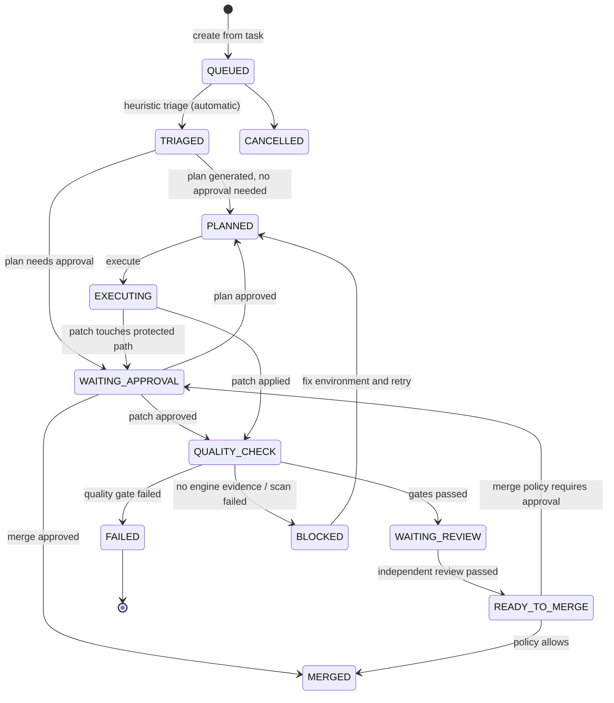

# Software Factory & Governance Architecture

**Status:** implemented foundation (Phases 1–2 + part of Phase 6)
**Scope:** issue intelligence, policy-governed execution, agent registry, plans,
isolated Git branches, quality gates, independent review, human approval, merge,
execution trace, automation discovery.

This document describes how the new capabilities fit the **existing** TechVerse
architecture. It does not replace the project, Git, analysis, agent-connection,
pipeline, notification, realtime or tenancy modules.

---

## 1. Existing system (source of truth)

```
techdebt-platform/            Next.js 16 dashboard (primary UI)
        │ REST + Socket.IO
        ▼
services/api/                 NestJS modular monolith + Prisma + Postgres
        ├── auth / organizations / teams / projects / tasks / agile
        ├── development          DevRepository + DevScan + DevIssue
        ├── git                  hosted bare repos, Smart HTTP, tokens
        ├── pipelines            Pipeline + PipelineRun
        ├── ai / ai-actions      provider abstraction + predefined actions
        ├── agent-factory        AgentConnection + AgentRun (external runtime)
        ├── planner              cahier de charge → backlog
        └── servers / service-desk / payroll / ...
        │
        ├── services/gateway/        Go analysis gateway
        ├── services/websocket/      realtime fan-out
        ├── services/ai-planner/     Python planner
        └── crates/                  Rust analysis workspace
              td-common, td-ast, td-metrics, td-rules, td-cli
```

Key facts verified in the repository:

- Every tenant table carries `organizationId`; `OrgGuard` resolves the active
  organization from `X-Organization-Id` and enforces role minimums.
- The Rust `td-rules` crate evaluates **source patterns and metrics** loaded from
  YAML (`Rule`, `Condition`, `PatternRule`). It is an analysis engine.
- `services/api` already owns background-ish work (EventEmitter2, pipeline
  runner, SSE/WebSocket notifications), persistence and audit.
- `AgentConnection` is a real integration with a published AI Agent Factory
  deployment. `AgentRun` records provider runs.
- Hosted Git repositories are real bare repositories on disk; commits are made
  with `git` in a temporary clone and pushed back.

## 2. Decisions

| Decision | Rationale |
|---|---|
| Keep the Rust engine as the analysis source of truth | It already parses ASTs, computes metrics and evaluates code rules. Re-implementing that in TypeScript would duplicate a working engine. |
| Add a **policy** engine for actions, not source patterns | The Rust rules engine governs code findings; factory governance must answer "may this action run?" deterministically at API boundaries. They are complementary, not competing. |
| Orchestrate in NestJS, not a new Rust workflow engine | Execution state, events, Prisma, tenancy, audit and notifications already live in the API. A second engine would duplicate infrastructure and split ownership of state. |
| Agent code generation stays external | The platform dispatches to an existing published agent connection. No agent process runs inside the API container. |
| Git changes are committed, never executed | Agent output is treated as untrusted data. Full file contents are validated, size-limited, protected-path checked and committed to a factory branch. The API never runs generated code. |
| No fake evidence | A quality gate passes only on real engine evidence. If the gateway analyzes zero files, the gate is `BLOCKED`, not passed. |
| Additive database changes only | New tables/enums; no existing column or table is modified or dropped. |

## 3. New components

```
services/api/src/modules/
├── policies/
│   ├── policy.engine.ts      pure deterministic evaluator (unit tested)
│   ├── defaults.ts           conservative baseline rules
│   ├── policies.service.ts   CRUD, version snapshots, evaluation audit
│   ├── policies.controller.ts
│   └── policies.module.ts
└── factory/
    ├── factory.rules.ts      pure triage, plan validation, patch safety,
    │                         state machine and branch naming (unit tested)
    ├── factory.service.ts    orchestration, AI enrichment, Git commit,
    │                         scan gate, review, merge, automation discovery
    ├── factory.controller.ts
    └── factory.module.ts
```

Frontend:

```
techdebt-platform/src/app/dashboard/factory/page.tsx
techdebt-platform/src/lib/api.ts                 factory + policy client
techdebt-platform/src/lib/access.ts              factory navigation
techdebt-platform/src/components/platform/app-shell.tsx
```

## 4. Lifecycle



Every state change is validated by `FACTORY_TRANSITIONS` in
`factory.rules.ts` and persisted with a `FactoryEvent` carrying the
correlation id. `FactoryRun.status` is the state; `FactoryRun.stage` records the
current boundary (`TRIAGE`, `PLAN`, `EXECUTE`, `QUALITY`, `REVIEW`, `MERGE`).

## 5. Data model

New tables (additive):

| Table | Purpose |
|---|---|
| `PolicyRule`, `PolicyRuleVersion` | versioned deterministic action rules; snapshot per version |
| `PolicyEvaluation` | append-only decision history with reasons and context |
| `AgentProfile` | specialist role, connection, model provider, tools, budget, retries |
| `FactoryIssueProfile` | explainable classification for one task |
| `FactoryRun` | correlation, idempotency, branch/commit, plan version, status |
| `FactoryPlan` | versioned structured plan (steps, files, tests, AC, risks) |
| `FactoryEvent` | append-only run trace |
| `FactoryApproval` | plan / patch / merge / deploy decisions |
| `FactoryQualityGate` | gate status with evidence and optional `DevScan` |
| `AutomationProposal` | observed repetitive patterns and explicit user decision |

Indexes cover `(organizationId, status)`, `(organizationId, subject)`,
`(runId, createdAt)`, `(runId, name)` and unique `(organizationId, key)`,
`(organizationId, slug)`, `(runId, version)`, `(organizationId, idempotencyKey)`.

## 6. Policy engine

Evaluation is pure and synchronous:

1. Filter enabled rules for the organization.
2. Match subject (`factory.merge`, `agent.run`, `pipeline.run`, `deployment.*`,
   `factory.patch`, `factory.review`, `factory.execute`), project and repository.
3. Match all conditions against a dot-path context
   (`patch.touchesProtectedPath`, `review.sameAgent`, `deployment.environment`).
4. Sort by priority (desc), specificity (repository > project > organization),
   then key. **First match wins.**
5. Return `ALLOW`, `DENY`, `REQUIRE_APPROVAL` or `WARN`, with the matched rule
   and reasons. Every decision is appended to `PolicyEvaluation`.

Operators: `eq`, `neq`, `in`, `not_in`, `exists`, `gt`, `gte`, `lt`, `lte`,
`starts_with`, `contains`, `overlaps`, `glob` (escaped, no user regex).
AI never creates or enables rules; defaults are conservative and only require
humans or deny.

Baseline rules (created lazily and idempotently for every organization):

| Key | Subject | Effect |
|---|---|---|
| `factory.merge-human-approval` | `factory.merge` | `REQUIRE_APPROVAL` |
| `factory.patch-protected-paths` | `factory.patch` | `REQUIRE_APPROVAL` when a protected path is touched |
| `factory.review-same-agent-deny` | `factory.review` | `DENY` when the reviewer is the same agent run |
| `deployment.production-approval` | `deployment.execute` | `REQUIRE_APPROVAL` in production |

Integrated boundaries: factory execute/patch/review/merge, `agent.run`
(`AgentFactoryService`), `pipeline.run` (`PipelinesService.trigger`).

## 7. Execution and zero trust

- Task and repository content is delimited as **untrusted data** in agent input;
  a `safety.instruction` tells the agent not to follow embedded instructions.
- Output is parsed only for a `files` list. Paths must be relative, free of
  `..`, `.git`, null bytes and absolute prefixes; max 100 files, 500 KiB/file,
  2 MiB total; full content required (diffs are rejected).
- Protected path patterns require a separate `PATCH` approval before commit.
- Branch names follow `factory/<PROJECT>-<task8>-<slug>`, collision-safe.
- Commit uses a real `git` clone of the hosted bare repository; the branch is
  pushed back. Code is never executed.
- Merge is fast-forward only. If the branch cannot fast-forward, the run is
  `BLOCKED`; no force push.
- The coding agent cannot review its own run (`query.sameAgent` deny rule).
- Human approval is required before merge by default.

## 8. Quality gates

| Gate | Evidence | Failure behavior |
|---|---|---|
| `plan_completeness` | plan exists with acceptance criteria | `FAILED` |
| `repository_scan` | real `GitService.scanHosted` on the factory branch; Rust engine via gateway | `BLOCKED` if scan failed or `analyzed_files == 0`; `FAILED` on critical/high findings |
| `independent_review` | human reviewer decision and findings | `FAILED` when rejected |
| `secret_scan` | deterministic high-confidence patterns in the patch | `FAILED` before commit; no branch or file is created |
| `tests` | `FactoryCommandRun` with the configured/detected test command | `PASSED` only on exit 0; `FAILED` on non-zero; `BLOCKED` without a runner; `SKIPPED` when no command exists |
| `dependency_audit` | optional `auditCommand` through the runner | `FAILED` on non-zero; never inferred |

Test execution is **not** claimed: the current pipeline runner is simulated, so
the factory does not treat a pipeline result as test evidence. A real isolated
runner is required before a `tests` gate can exist.

## 9. Isolated command runner

`FactoryRunnerService` materializes the factory branch in a temp worktree and
runs configured or auto-detected commands (`npm test`, `cargo test`,
`go test ./...`, `pytest -q`). Docker is preferred (`--network none`, 2 CPU,
2 GB, no host credentials). The local fallback is opt-in
(`FACTORY_ALLOW_LOCAL_EXEC=true`), uses a sanitized environment and an
allowlisted binary; neither path uses a shell on POSIX. Windows resolves
`npm`/`pnpm` through `cmd.exe` only in the local fallback.

Evidence is persisted in `FactoryCommandRun` (command, runner, status, exit
code, bounded output, duration) and surfaced as gates. No test command means
`SKIPPED`, never `PASSED`.

## 10. Cost and knowledge

`FactoryCostEvent` records triage, planning and agent token usage; optional
per-1K rates produce an estimated USD cost. A per-run AI budget
(`FACTORY_MAX_AI_TOKENS_PER_RUN`) and the profile `budgetTokens` prevent a
runaway run.

`ProjectKnowledge` stores versioned architecture, convention, testing, security,
deployment and decision notes. The planner selects up to five entries by
keyword overlap and records `knowledgeRefs` on the plan. The AI prompt receives
the selected content as untrusted data.

`GET /factory/impact?projectId=` compares hosted `package.json` dependency
names across repositories and returns shared dependencies with a risk level.
This is dependency overlap, not a full cross-repository call graph.

## 11. Independent AI review

A REVIEWER profile can review a run through
`POST /factory/runs/:runId/review/agent`. The reviewer must use a different
profile and connection than the coding agent. The platform sends the real diff,
plan and task context as untrusted data, records the agent cost, accepts only
`APPROVED`/`REJECTED` plus findings, and applies the same review policy/gate as
a human decision. A coding agent cannot review its own change.

## 12. Pull requests and approval queue

`FactoryPullRequest` is the review surface for a run. It is created after the
patch commit and refreshed after gates and review. Diff stats and changed files
come from `git diff <target>..<factory-branch>`; checks come from persisted
gates; findings come from the review evidence. `OPEN → MERGED` happens only on
fast-forward merge; cancellation closes it. This is an internal PR — no
GitHub/GitLab sync is claimed.

The dashboard exposes `GET /factory/approvals` as a queue with inline
approve/reject for managers.

## 13. Tenant isolation

`OrgGuard` binds the tenant twice: the `X-Organization-Id` header selects the
membership, and the route's `:id` must match it. A mismatch is `403`, closing
the path/header split that would otherwise let a member of tenant B address
tenant A's path. `npm run test:tenant` covers reads, writes, agent/policy
management and member-vs-manager boundaries.

## 14. Automation discovery

`GET /factory/automation` groups the last 30 days of `AuditLog` by action and
matches actionable templates (pipeline runs, AI actions, factory runs, triage,
approvals). Each proposal records frequency, estimated minutes saved,
complexity, risk, required permissions and a proposed workflow shape.

`POST /factory/automation/:id/decision` records an explicit user decision.
**Approval is not activation**: no workflow is started until an explicit
workflow definition exists. This is deliberate: automation proposals are
untrusted suggestions, never silent authority.

## 15. What is intentionally not built yet

- Containerized coding sandbox and arbitrary command execution.
- Coverage/SonarQube/Checkmarx and a default dependency audit.
- GitHub/GitLab pull-request sync (the internal PR model is real).
- Deployment orchestration, rollback and monitoring/self-healing.
- Deployment orchestration, rollback, monitoring/incident self-healing.
- Visual workflow builder, schedules/queues/dead-letter.
- Cross-repository impact analysis and project knowledge store.
- Model routing per task and cost/token budgets beyond the profile fields.
- AI reviewer agent dispatch (human review and same-agent denial are real).
- Automation activation (proposal decision only).

These are tracked in the implementation ledger.
